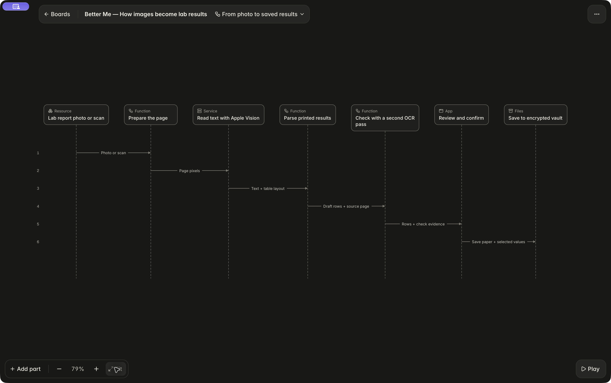

As I get older, I find myself visiting doctors and clinics more often. The problem is that every visit leaves me with another piece of paper, or prescription, and none of these records are connected.

In Better Me, I can keep those papers with my medicines and readings, then pull them together before an appointment. The Visit page shows what changed since the last visit and keeps the questions I want to ask.

**Show my doctor** opens a report I can hand over on the phone or share as a PDF. It compares readings over equal periods and puts each lab result beside the previous one.



I can scan a Japanese pharmacy slip's supported QR code instead of typing each medicine. Apple Health readings come directly from Health, with permission.

## Reading the papers

Lab reports often put several dates in the same table. Reading the digits correctly is no help if the app takes last year's result from the next column.

I can photograph a report, scan it, or import a file. Apple Vision reads the English or Japanese text on the phone. Code then works through the table to find the test names and their values, keeping the units and printed ranges. This part doesn't use a language model.

A second pass reads the page again and flags disagreements. I check the date and compare the values with the paper before saving. Uncertain results start unchecked; I can correct them or just keep the paper without extracting anything.

*The import flow in Mooomooo. Open the image to read it at full size.*

The saved results link back to the source page. Missing values stay missing, and the app doesn't label a result good or bad. It shows the printed range. Comparing records around a medicine change doesn't establish what caused the change.

## What I share

I choose the dates and sections the doctor sees. The same choices apply to the PDF. Hiding something from the report doesn't delete it.



The records are encrypted on my iPhone, with no account or cloud sync. There is no external AI connection. Usage and crash reporting are off by default, and I choose when to share or export records.

Moving the vault to a replacement iPhone is still unfinished. I can export the records, but there isn't a restore process yet.

The app supports English & Japanese. Camera capture still needs physical-device checks, followed by use at an actual appointment.

This is a personal tracking project, not medical advice. I still take the results to my doctor.
