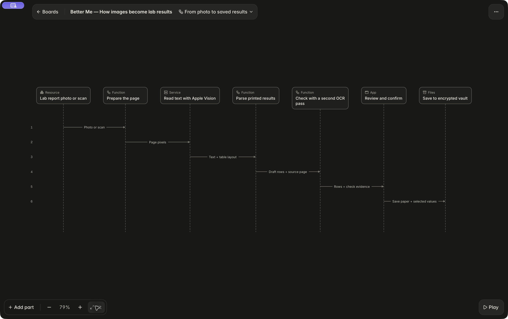

*Updated 10 November 2026 to reflect the current Better Me build.*

As I get older, I find myself visiting doctors and clinics more often. Every visit leaves me with another piece of paper or prescription. None of these records are connected.

I started Better Me because I wanted one place to keep them. The first version had an interactive 3D body. I could tap an organ and attach a report. It also tracked fasting and daily habits.

The app has changed considerably since I wrote this post. Its main job is now specific: help me walk into my next doctor visit with one clear page.

That meant removing things, including the body interface and fasting. The current build starts with the visit.

## One page for the doctor

The Visit page brings together the next appointment, questions to ask, and changes since the last visit. **Show my doctor** opens the report.

Readings sit beside the previous period of the same length. Printed lab results sit beside their earlier results. Medicines, notes, and papers give those numbers context.



The smaller details matter here. A missing record stays unknown. A comparison does not claim that a medicine caused a change. The app keeps printed reference ranges without deciding whether a result is good or bad.

I can also scan a supported Japanese pharmacy slip's QR code to fill the medicine list. With permission, Apple Health supplies readings when the page needs them. Better Me does not copy those readings into its vault or write back to Apple Health.

## From a photograph to a saved result

Getting a number out of a photograph is only part of the work. The number needs the right test name, unit, and date. A previous result printed in the next column must not become today's result.

The current import uses Apple's on-device text recognition and parsing rules. A language model does not extract the lab results in this build.

1. I take a photo, scan the pages, or choose a file. The app prepares the page for reading.
2. Apple Vision reads English and Japanese text. The parser uses the table layout to identify test names, values, units, and printed ranges.
3. A second text-recognition pass checks the proposed values. Disagreements become review evidence; they do not silently replace a number.
4. I check the report date and values against the page. Uncertain results start unchecked. I can correct them, enter values manually, or keep only the paper.
5. Saving keeps the source page, recognized text, and selected results together in the encrypted vault. Each result links back to its paper.

*The “From photo to saved results” flow in my Mooomooo board, “Better Me — How images become lab results”. Open the image for the full-size view.*

Text recognition can still be wrong. The review step remains part of saving a result.

## Choosing what leaves the phone

Before showing the report, I can change its time range and choose which sections to include. Those choices apply to the preview, the doctor view, and the PDF. Hiding a section leaves its records saved.



Records stay in an encrypted vault on the iPhone. There is no account, cloud sync, or external AI provider. Usage and crash reporting are off unless enabled. Sharing a PDF or exporting records is an explicit action.

Local storage also leaves a practical gap: moving the vault to a replacement iPhone is not built yet. Exporting records is not the same as restoring them.

The interface now uses familiar iPhone controls, with English and Japanese text and support for larger type. The remaining work includes checking camera capture on physical devices and seeing whether the page helps during an actual appointment.

Better Me organizes my records. It does not diagnose or recommend treatment. Medical decisions stay with the doctor.
