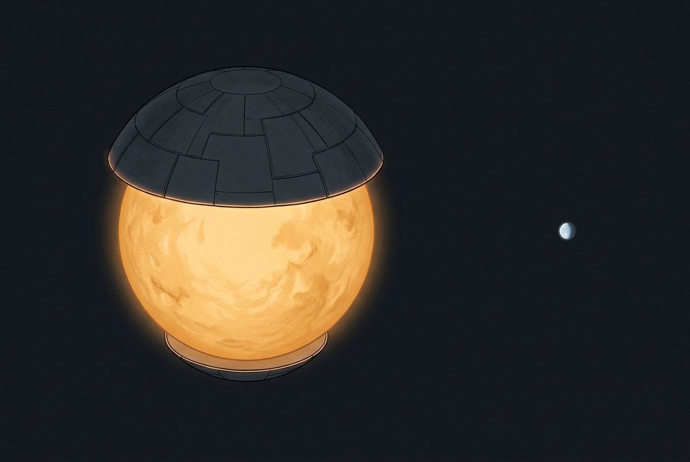
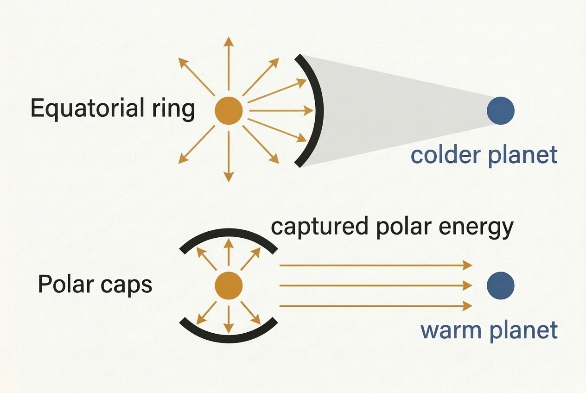
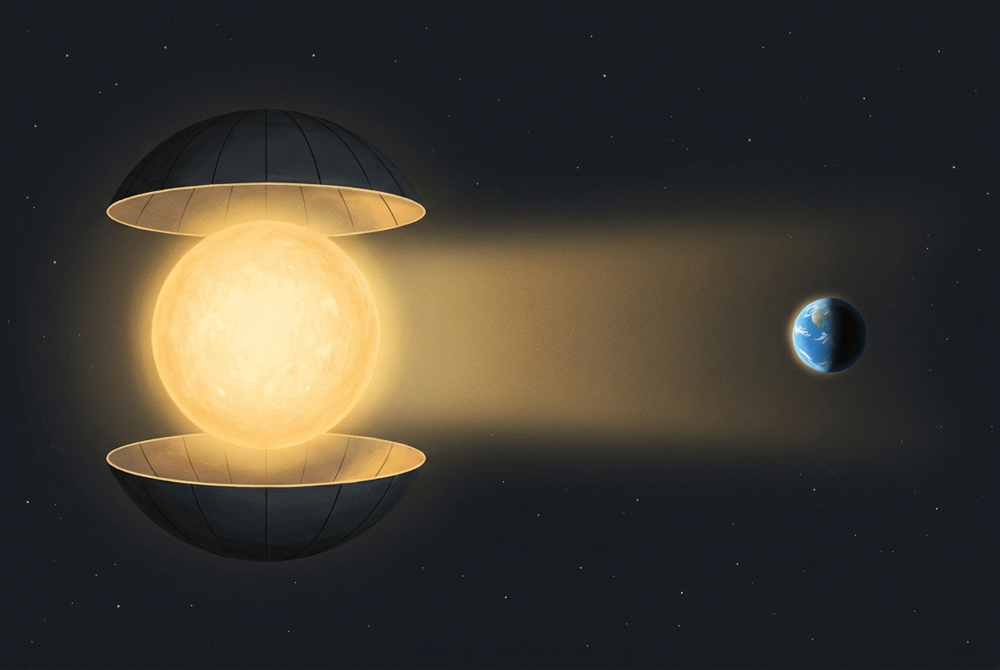

From Earth, TYC-8841 looked ordinary.

Every survey had observed the star edge-on along its orbital plane, because edge-on is how you catch transiting planets. Four worlds traced clean orbits around a steady yellow sun. The second sat in the temperate band, wrapped in ocean and thin cloud.

Only one note in the catalog refused to settle: a steady infrared glow near 290 Kelvin with no optical dimming to match it. Warm dust along an orbital plane reddens a star and scatters its light. TYC-8841 showed none of that. Two survey teams blamed a faint background object behind the line of sight and moved on.

Nadia only saw what was actually there because the scout ship *Kestrel* dropped into the system sixty degrees above its orbital plane.

When the sunshade cleared and the optical feed opened over the north pole, the star looked cut in half.

Suspended clear above the northern crown hung a wide, matte-black bowl built from curved, interlocking plates. Telemetry from the trailing relay probe confirmed a matching bowl under the south pole. Between them, the star's equatorial belt burned unobstructed.

Her first guess was that the builders had walked away halfway through.

Everything in a star system wants to lie flat along the equator. Hauling metal and silicon out of that plane to park ninety degrees over a pole carries a steep fuel penalty. Worse, a polar cap cannot coast in a normal orbit. It has to hover, balancing gravity against the outward push of the star's own light. Starting at the hardest place in the sky while leaving the cheap middle empty made no sense. Maybe a war had cleared the belt. Maybe they had run out of material and left.

She slewed the narrow-field camera onto the second planet, expecting gray ice and empty continents.

Instead, she found amber.

Thin webs of light traced the night-side coastlines and inland river valleys. Low-power radio beacons pulsed quietly between orbital relays and the surface. Whoever raised the polar shells had never left. They were still down there, living in ordinary daylight.

Nadia zoomed back out and measured the open belt around the star's waist. Both dark bowls stopped along a clean rim twenty degrees north and south of the equator, leaving a forty-degree window all the way around.

She plotted the light paths against the second planet's orbit, and the geometry clicked.

A star throws almost all of its light into empty space. From its center, a planet is a pinhole moving along a thin equatorial track. Had the builders taken the cheap route and wrapped a swarm around the equator, they would have parked metal straight between their sun and their oceans. Even a partial ring trims the light along the plane. Winters lengthen. Coasts freeze. You either abandon the ground or spend half your harvest warming a world you just put in shade.

Two polar caps reaching down to twenty degrees still cover two-thirds of the sky around a star. Every photon they catch was headed off into empty space anyway. Meanwhile, the light aimed at the second planet passes straight through the open waist without touching a single plate.

They had paid the steep cost of lifting their collectors out of the plane for one reason: so nothing would ever cross their sun.

As *Kestrel* pitched down toward the orbital plane, the two dark bowls slipped away above and below the glare. By the time the ship crossed the equator, they were gone from sight, hidden again from any telescope looking edge-on. Only an unbroken stream of daylight remained, stretching out to the blue world in the distance.

Nadia saved the survey log and closed the feed. On the planet below, noon looked unchanged, while two dark bowls over the poles kept gathering the light that missed home.
